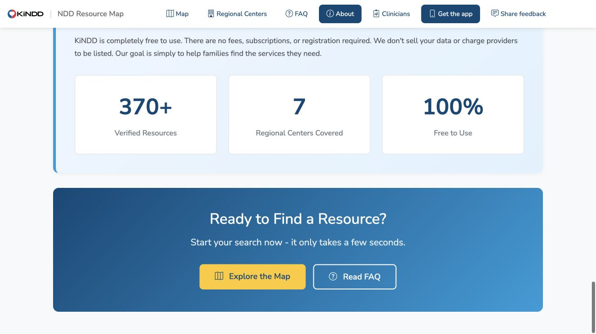
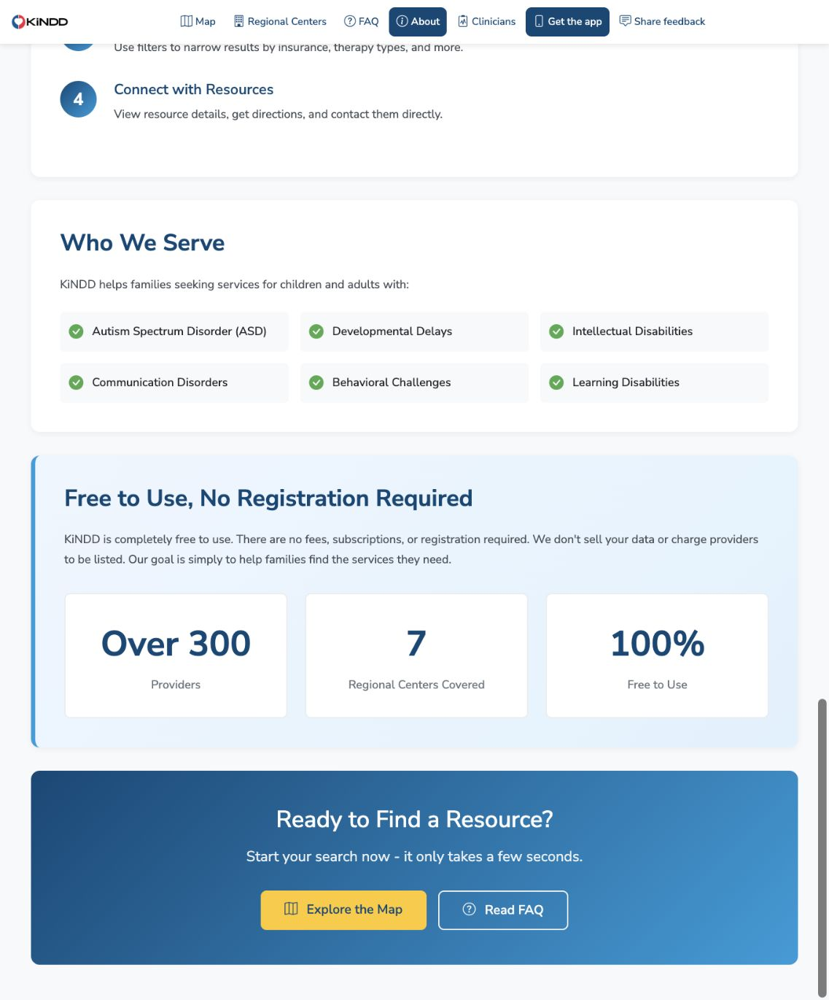
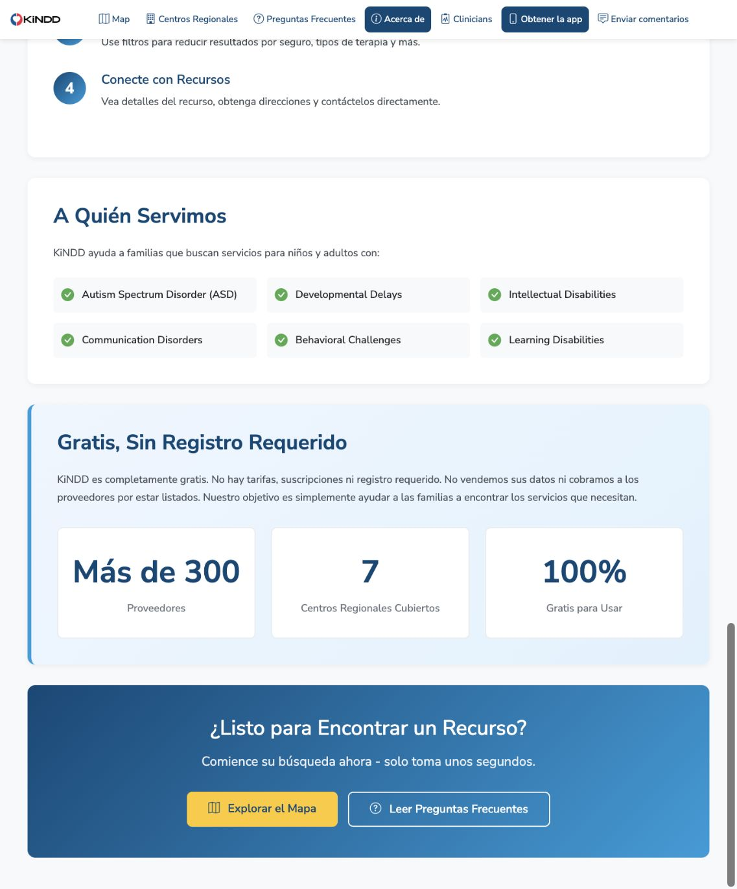

# Provider-count copy verification

Checked on October 22, 2026 for PR #39.

The published web About page showed `370+` and `Verified Resources`. The local production build shows `Over 300` and `Providers`, with `Más de 300` and `Proveedores` after switching to Spanish through the introduction page's language menu.

The source audit covered web, iOS, Android, current store-description files and reusable social copy. Android has no static directory-total claim. Search-result totals, regional-center-specific statistics, addresses, coordinates and historical records retain their original values.

Verification passed:

- `cd map-frontend && npm ci && npm run build`, including every prerender route. An initial attempt using the shared checkout's installed dependencies failed to launch its old Puppeteer version. A clean install from the unchanged lockfile resolved it.
- English and Spanish browser checks against `npm run preview` on port 5187. The generated `dist/about/index.html` contains `Over 300` and `Providers`, with no `370+`.
- `xcodebuild -project CHLA-iOS.xcodeproj -scheme CHLA-iOS -sdk iphonesimulator -destination 'generic/platform=iOS Simulator' -derivedDataPath /tmp/kindd-provider-count-ios CODE_SIGNING_ALLOWED=NO build` from `chla-ios`.
- Both iOS localization files pass `plutil -lint`. Web locale JSON parses, and `git diff --check` passes.

iOS simulator compilation passed; native screen layout and device execution were not checked. No production deployment, App Store binary upload or App Store Connect metadata publication was performed.

Before, published About page, 1280 × 720:

After, local production build in English, 1137 × 1370:

After, local production build in Spanish, 1137 × 1370:

